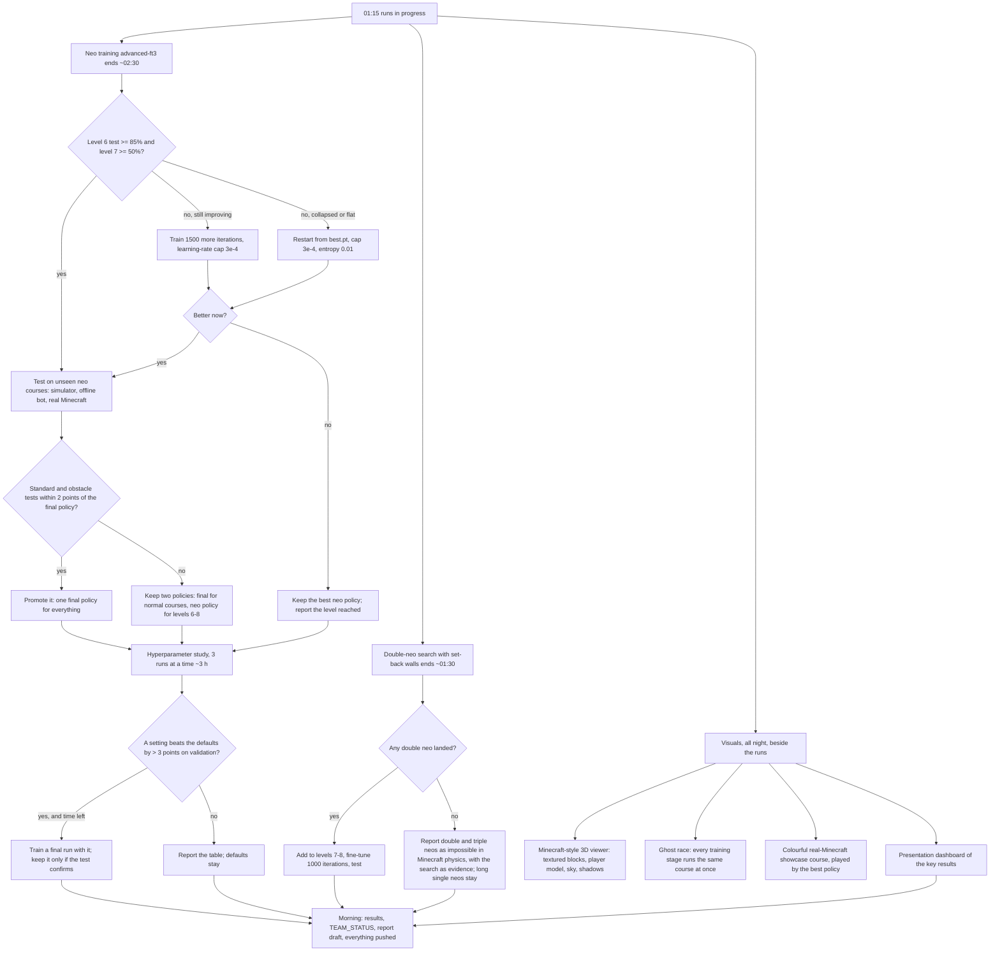
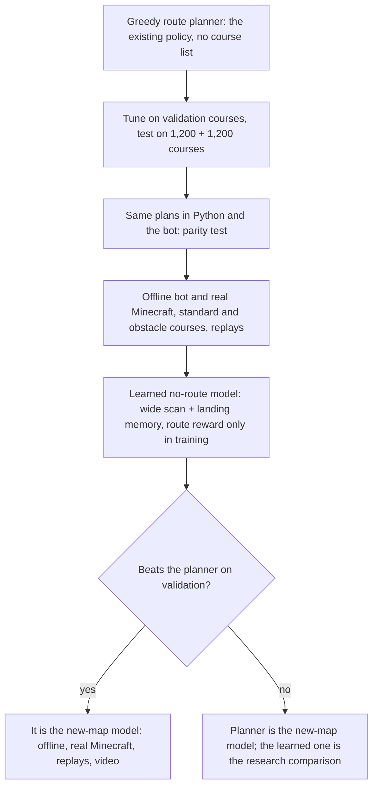

# Overnight plan, 28 October 2026 (decision tree)

Written at 01:15 before the user went to sleep. Each branch says what the
assistant does depending on what the runs show. Every outcome is recorded in
TEAM_STATUS.md and pushed.

## Rules for the night

- Never more than three training processes on the GPU at once (more spills
  into system RAM and everything slows 5 to 10 times).
- Every claim keeps saying where it was measured: simulator, offline bot
  (Mineflayer's physics without a server) or real Minecraft.
- Visuals never change the physics or the policy. Colourful blocks in real
  Minecraft are full cubes with normal friction only (concrete, quartz, gold,
  emerald), so the bot moves exactly as on stone.
- The previous final policy stays available whatever happens.

## Update, 02:40: two new branches (requested from the side chat)

Rule change: at most two training processes on the GPU (a third now spills
out of GPU memory and slows all of them about 8 times).
