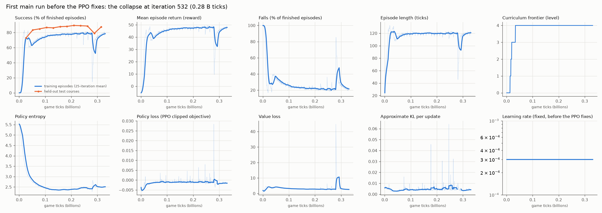
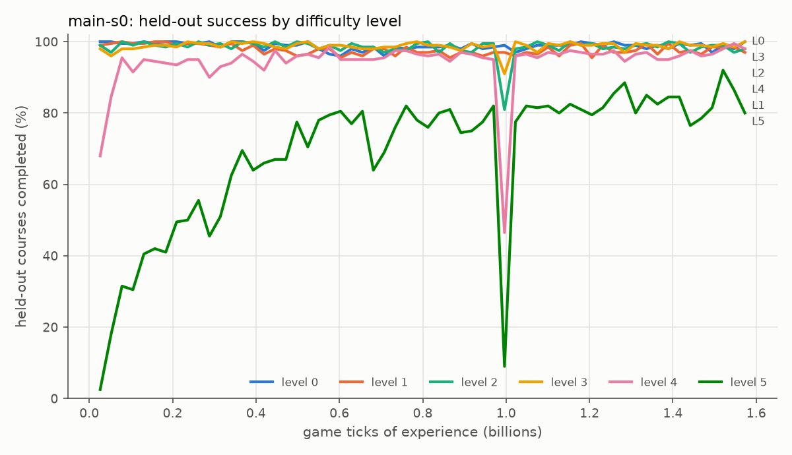
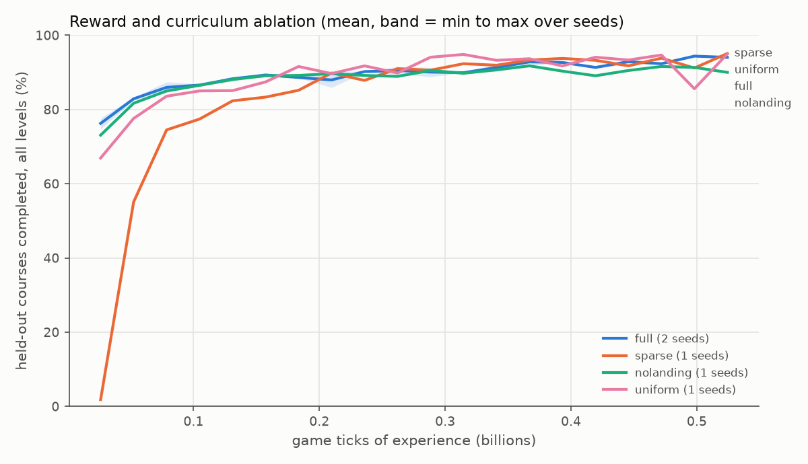
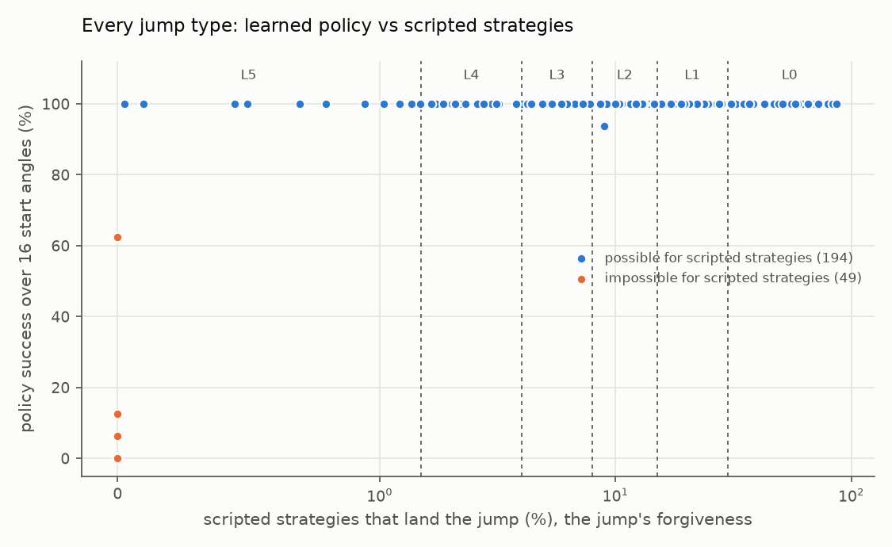

# Learning Minecraft Parkour That Transfers to Unseen Courses

## 1. Introduction

Parkour in Minecraft is a sequence of precise jumps between small blocks
over a void. A player must judge distance, height and direction, build up
speed, and press jump on the right game tick; one mistake ends the run. We
ask whether a reinforcement-learning agent can learn this skill well enough
to complete **courses it has never seen**, and whether what it learns in
simulation holds in the real game.

Our contributions:

1. A GPU simulator matching prismarine-physics, a Mineflayer bot's movement
   engine, to 1.4e-14 blocks (section 3).
2. A study of how forgiving 243 jump types are, defining six levels and a
   curriculum (sections 4 and 5).
3. A PPO agent that completes held-out courses, with ablations of our first
   reward ideas (distance to the goal, number of jumps, height), the
   curriculum and the route input (sections 5 and 7).
4. A Mineflayer bridge running the network in real Minecraft, checked tick
   by tick against the simulator (sections 6 and 7.6).
5. Neo jumps around a wall's end, which exploration never found: learned
   from search demonstrations and DAgger (section 7.7), and planned at play
   time with the exact simulator, narrowly meeting our 85% single-neo goal
   (section 7.8).
6. Routing without being told the platforms: a greedy planner, and a learned
   router that beats it (section 7.9).
7. One network for every skill, matching the specialists, and a learned
   skill gate (section 7.10).

## 2. Related work

- **Reinforcement learning in Minecraft** has mostly targeted survival and
  crafting from human data (MineRL, Guss et al., 2019; VPT, Baker et al.,
  2022). We isolate movement and replace human data with a faithful
  simulator.
- **Learned parkour and locomotion.** Varied terrain makes agile locomotion
  emerge from simple rewards (Heess et al., 2017), and robot parkour trained
  in parallel simulation transfers to real robots (Zhuang et al., 2023; Cheng
  et al., 2024). We follow that recipe with the bot's own physics engine
  reproduced exactly, so the reality gap is measurable: rounding error,
  except next to wall corners (section 7.8).
- **Massively parallel PPO.** Rudin et al. (2021) trained legged robots in
  minutes on thousands of GPU environments. We use their KL-adaptive learning
  rate with PPO (Schulman et al., 2017), GAE (Schulman et al., 2016) and dual
  clipping (Ye et al., 2020).
- **Generalisation and curricula.** Procgen (Cobbe et al., 2020) showed that
  agents trained on few levels overfit; we train on endlessly generated
  courses and test on disjoint seed families. Curricula (Bengio et al., 2009)
  motivate our level schedule, and potential-based shaping (Ng et al., 1999)
  the progress reward.
- **Search and hierarchy.** Our neo searches use the cross-entropy method
  (Rubinstein, 1999); DAgger (Ross et al., 2011) queries them in the
  learner's states. The learned router and the gate make one choice per
  landing: an option in a semi-MDP (Sutton et al., 1999). The one network
  distils the specialists (Rusu et al., 2016), and the gate is a mixture of
  frozen experts (Jacobs et al., 1991).

## 3. A faithful simulator

**Why it can be faithful.** A Mineflayer bot computes its own movement on the
client with prismarine-physics and sends the resulting position to the
server. The server re-applies the move with the game's own collision order;
in 40 recorded runs it sent the bot back (a correction) only when the two
results differed by more than 0.25 blocks, which happened only next to wall
corners (section 7.8).
Otherwise the bot's movement in real Minecraft is prismarine-physics. The bot
never applies a 1.21 server's extra sprint modifier, so it sprints like the
vanilla client and the simulator.

**The port.** `parkour/physics.py` re-implements prismarine-physics 1.11.1
(PrismarineJS), batched in PyTorch, in float64, keeping the operand order of
the JavaScript source: ground and air acceleration, sprinting, the
sprint-jump boost, drag, gravity, the jump cooldown, axis-by-axis collision
against block boxes, and step-up. Levels 0 to 5 contain only air and full
cubes. Ice, block shapes (slabs, stairs, fence posts and more), slime and
ladders are opt-in, each exact against prismarine-physics
(`results/physics_parity_*.json`); water is not modelled.

**Validation.** `parkour/parity.py` runs prismarine-physics through Node, with
the 1e-7 collision tolerance that the simulator and the bot share (vanilla's
rule), on random block fields (pillars, steps, ceilings, gaps, edges) with
random inputs, and compares every tick: over 99,000 ticks on the CPU and the
GPU (`results/physics_parity.json`) the largest position difference was
1.4e-14 blocks, and every on-ground, collision and cooldown flag matched.

## 4. Courses and difficulty

A course is a chain of stone platforms in the void. Each jump has a gap (0 to
5 air blocks), a height change (-3 to +1), a sideways offset (0 to 2) and a
landing size (1x1, 2x2 or 3x3).

**Feasibility study.** For each of 243 jump types we simulate 4,032 scripted
strategies from a standing start on a 1x1 block (start position, aim point,
jump tick, sprint or walk, forward release). The fraction that lands is the
jump's *forgiveness*. Scripted strategies land 194 types; flat 1-, 3-, 4- and
5-block gaps have forgiveness 0.47, 0.08, 0.01 and 0. Six forgiveness bands
define levels 0 to 5.

**Generation.** A level-L course draws half its jumps from level L and half
from easier levels, turns with probability 0.25, and keeps one air block
between non-consecutive platforms and each flight path clear of earlier
platforms. Training courses have 5 to 12 jumps, test courses 10 (fewer if no
jump fits).

**Held-out sets.** Each set has its own seed family; training uses family
0, minus any course equal to a held-out one. Standard and obstacle courses
(a head-hitter beam or decoy pillar on half the jumps): test families 1 and
4 (200 per level), validation 2 and 5 (100 per level; larger draws in
sections 7.7 to 7.9). Single-neo courses (one neo among ten jumps): test
41, validation 40 (320 each, section 7.8). Level 5 with and without
obstacles: validation only, 46 and 47 (2,000 each, section 7.5). Ice on 30%
of platforms: test 16, validation 17 (section 7.10).

## 5. MDP and learning

**State.** The course; the player's float64 position and velocity, yaw,
on-ground and collision flags and jump cooldown; the progress index *k* (the
furthest platform stood on); tick and stall counters; the previous action.

**Observation (255 numbers).** In the player's frame: velocity, on-ground,
jump cooldown, horizontal collision (6); previous action (5); platforms *k*
to *k*+3, each: valid and goal flags, four top-face corners, top height (44);
floor height and ceiling flag at 98 points from 1 block behind to 5.5 ahead,
1.5 to each side (196); goal offset (3); fraction of platforms reached (1).
Later platforms (except the goal), obstacles outside the scan and the
counters are hidden: a POMDP, played by a memoryless policy.

**Actions (252).** Factored: move (back, none, forward) x strafe (left, none,
right) x jump x sprint x yaw step (-20, -6, -1.5, 0, 1.5, 6, 20 degrees,
applied before the tick's movement).

**Dynamics.** Deterministic: each 50 ms step is one tick of the float64 port
of prismarine-physics. Randomness: the course drawn at reset and, in
training, the sampled actions.

**Initial state.** A level from the curriculum (below), a training course of
that level, the player at rest on platform 0's centre, facing within 60
degrees of platform 1 (fixed per course), *k* and the counters 0, no
previous input.

**Discount.** 0.995 (final policy, section 7.3; default 0.99).

**Reward and episode ends** (`RewardConfig` defaults, as in the final
policy; our first ideas in brackets):

| Term (idea) | Reward | Episode |
| ------ | ------------- | ----- |
| progress (distance to the goal) | decrease of the path left to the goal (feet to the next platform's top centre, then centre to centre), weight 1 | continues |
| landing (number of jumps) | +1 for each platform *k* advances (skipped ones count) | continues |
| goal | +10 on standing on the last platform | terminal |
| fall (height) | -5 when the feet are more than 1 block below the lowest top of platforms *k*-1 to *k*+2, or the player stands on an obstacle | terminal |
| stall | 0 after 200 ticks without a new platform (-5 in section 7.7) | truncated, value bootstrapped (terminal if penalised) |
| time | -0.01 per tick | continues |

A 3,000-tick truncation never binds: the stall rule caps episodes at 2,400
ticks.

**Algorithm.** PPO with GAE (lambda 0.95), separate actor and critic MLPs
(512-256-128, ELU), observation standardisation, 16,384 environments, 32-tick
rollouts, 4 epochs of 8 minibatches, clip 0.2, entropy 0.005. The level-5
fine-tunes, DAgger round 4 and the runs of section 7.10 used 8,192
environments, 64-tick rollouts and 32 minibatches (the gate 8). A tabular
method cannot generalise across course geometries, so function approximation
is required.

**Curriculum.** Levels up to a frontier are sampled with weight 1, the next
level with weight 3; the frontier advances when the next level's success
rate reaches 60% over 2,000 episodes.

**Stability.** Our first runs made three catastrophic updates (approximate KL
of 0.3, 1.3 and once infinity; training success fell from about 75-80% to
15-17% within two iterations). We added a log-ratio clamp, dual clipping, a
per-minibatch KL stop at 0.05 and a KL-adaptive learning rate (target 0.01).
No catastrophic update recurred, though training success still dipped at
times.

*Figure 1: a run before the safeguards (`results/runs/_v1_unstable`): its
catastrophic update (infinite KL, not plotted) shows as a sudden drop in
training success.*

## 6. From simulator to Minecraft

The trained actor, exported as JSON, runs in JavaScript inside the bot's
physics tick (`bridge/policy.js`, `bridge/parkour_bot.js`): after each tick
the bot builds the observation from the game, picks the argmax action and
sets yaw and controls for the next tick, in the simulator's step order. A
local Minecraft 1.21.4 void-world server (`parkour/server.py`) hosts the
runs; the bot builds each course with /fill, teleports onto the start block
(the reset) and uses only movement controls during an episode. The same
JavaScript on prismarine-physics without a server is the *offline bot*.

The *replay check* re-simulates the recorded actions from the recorded start
state and compares positions tick by tick. The *policy check* plays the
course in the simulator from the same start, after 10 idle ticks on the
start block, and compares outcomes.

## 7. Results

Every number comes from a file under `results/`, `runs/` or `configs/`;
`results/README.md` gives an overview. Unless stated otherwise, numbers are
simulator results on the held-out test sets (section 4) with the
deterministic policy. Checkpoints and settings were chosen on validation
courses only. Earlier runs also logged test curves (figure 2) without
choosing on them; after 28 Oct each setting's test was played once.

### 7.1 Main run

With section 5's settings and discount 0.99, the main run trained for 3,000
iterations (1.57 billion game ticks, 2.6 hours on one RTX 5080). Its last
checkpoint completes **95.5%** of the 1,200 test courses (level 5: 80%).
Levels 0 to 4 pass 90% within 0.08 billion ticks, and level 5 reaches 78% by
0.55 billion (figure 2; the drop at 1.0 billion lasted one evaluation).
Section 7.3 repeats it with discount 0.995.

*Figure 2: held-out test success per difficulty level during the main run
(`main-s0`), every 50 iterations.*

### 7.2 Reward, curriculum and route ablation (3 seeds per arm, 0.52 B ticks each)

| Arm | Final success, mean (min-max) | Level 5, mean (min-max) | Ticks to 80% |
| --- | --- | --- | --- |
| full | 93.3% (91.9-94.2) | 72.0% (69.0-76.5) | 0.05 B |
| no distance shaping (`sparse`) | 93.6% (91.5-95.1) | 74.8% (70.0-79.5) | 0.14 B |
| no landing bonus (`nolanding`) | 91.8% (90.0-94.2) | 59.5% (47.0-74.5) | 0.05 B |
| no fall penalty (`nofall`) | 90.9% (90.5-91.2) | 55.2% (54.0-57.0) | 0.05 B |
| no curriculum (`uniform`) | 94.0% (93.0-95.0) | 72.0% (67.0-76.0) | 0.08 B |
| no route: platform slots hidden (`noroute`) | 82.4% (80.6-83.6) | 43.0% (39.0-47.5) | 0.38 B |

*Figure 3: held-out success during training for each ablation arm, 3 seeds per
arm.*

- Of the reward terms, the **fall penalty** (the height idea) matters most:
  without it the final success and the level-5 success fall below every seed
  of the full arm.
- **Distance shaping** does not change the final success but makes learning
  about three times faster.
- Without the **landing bonus** level-5 success is lower on average, but the
  seeds overlap, so three seeds show no reliable effect.
- The **curriculum** does not raise the final score at this budget; uniform
  sampling learns slightly more slowly (0.08 against 0.05 B ticks to 80%) and
  ends equal.
- Hiding the **route** costs most: the agent needs about seven times as many
  ticks to reach 80% and ends at 82.4%. Its scan sees 5.5 blocks ahead and 1.5
  to each side, so after a turn the next platform is often outside it.

### 7.3 Hyperparameters and the final policy

One setting at a time around the defaults, seed 0, 0.52 B game ticks each,
chosen on validation, test reported (`configs/sweep_hparams.json`). The
defaults score 91.8% on validation (2 seeds) and 93.3% on test (3 seeds, level
5: 72.0%).

| Change | Validation | Test | Level 5 |
| --- | --- | --- | --- |
| discount 0.98 | 89.2 | 90.4 | 58.0 |
| **discount 0.995 (3 seeds)** | **95.4** (95.2, 95.8, 95.2) | **95.2** (95.0, 94.9, 95.6) | **76.3** |
| entropy 0.001 | 94.3 | 94.1 | 70.5 |
| entropy 0.02 | 91.0 | 91.5 | 64.0 |
| KL target 0.005 | 89.7 | 90.8 | 52.5 |
| KL target 0.02 | 92.2 | 91.8 | 62.0 |
| network 256-128 | 92.5 | 91.3 | 56.0 |
| network 1024-512-256 | 94.5 | 95.4 | 83.5 |
| 4,096 environments (4,000 smaller updates) | 91.5 | 92.0 | 60.0 |

Only a longer horizon passed our bar of 3 points over the defaults on
validation, in all three seeds (+3.6 validation, +1.8 test, +4.3 level 5).
A 10-jump course takes about 120 to 200 ticks; with discount 0.99 the goal
bonus is worth 30 to 13% of its value at the start, with 0.995 55 to 37%, so
the far goal pulls harder. The large network is the best single run on level
5 (83.5%), but it is one seed and below the bar on validation.

We then trained discount 0.995 at full length: 3,000 iterations as in the
main run (`main-g995`), then the obstacle fine-tune of section 7.5
(`obstacles-g995`). Its validation pick (iteration 699) beat the first final
policy (`obstacles-ft`, the same fine-tune of `main-s0`) there, 97.6%
against 96.6%, and became the final policy (`results/final_policy.pt`). On
the test sets it completes 98.4% of standard courses (level 5: 93.5%)
against 97.1% (90.5%), and 95.2% of obstacle courses (level 5: 81.0%)
against 93.6% (75.5%).

### 7.4 Jump types and course styles

From a standing start on a 1x1 block at 16 start angles, the final policy
makes every jump type of levels 0 to 4 every time and the level-5 types 99.1%
of the time. Of the 49 types that none of the 4,032 scripted strategies lands,
it makes 3 at least once, including a diagonal 4-block gap onto a 3x3 platform
from 15 of the 16 angles (figure 4).

*Figure 4: each dot is one jump type: the final policy's success over 16 start
angles against the jump's forgiveness (section 4); dashed lines separate the
levels.*

On course styles outside training (100 new courses per level and style) it
completes 93.0% of courses made only of single blocks, 94.2% with a turn at
every jump, 96.5% of 15-jump courses, 96.7% from any start direction and 98.3%
of straight lines (standard courses: 98.3%). The weakest cases are level-5
courses of single blocks (75%) or with a turn at every jump (80%).

### 7.5 Obstacles

Before obstacle training, the main run's policy completed 46.8% of new courses
with head-hitter beams and decoy pillars on half the jumps (stress test, 100
per level), against 96.7% of standard ones. The obstacle fine-tune trains for
1,000 iterations with an obstacle on 30% of jumps; after it, the same run
completes 95.3% of such courses, and the final policy (the same fine-tune of
`main-g995`, section 7.3) 96.3%. On the obstacle test set, level 5 (81.0%)
is its weakest part.

Over three seeds, fine-tuning the final policy with obstacles on half the
jumps and level 5 weighted 3 to 1 gains 2.67 points on family 46 (2,000
level-5 validation courses with obstacles, created after the first run of this
recipe and of the obstacles-only one had been tested; every seed gains) and
lifts the obstacle test set's level 5 from 81.0% to 83.8%, with standard
courses unchanged. Each change alone stays within half a point on family 46
but rises about as much on test (82.8% and 84.2%), so the test does not
confirm that both are needed; with no fine-tune that has neither change, the
test's rise may also come from the extra training itself. We report it but
keep the final policy, which the planners, the router and the bots use.

### 7.6 The bot, offline and in real Minecraft

The offline bot and the bot in real Minecraft (section 6), the latter in
real time, each played the final policy on 60 held-out standard courses, 60
held-out obstacle courses and 4 hand-designed courses. Both completed 59, 57
and 3 of them: exactly the courses the simulator completed, with the same
tick counts. The failed hand-designed course is built around neo jumps
(section 7.7), which this policy never trained on; it stalls at the first
neo. The server never corrected the bot's position (0 corrections in 124
episodes), and the replay check reproduced every trajectory to within
7.1e-15 blocks offline and 2.1e-14 blocks in the game. On these courses the
gap between simulation and the game is rounding error; at a wall's corner
the game's collision order can widen it (section 7.8).

### 7.7 Neo jumps: refusal, demonstrations and DAgger

**What is possible.** A neo jumps around the end of a wall: the player takes
off beside it, swings around its end in the air and lands on the far side. A
cross-entropy search (Rubinstein, 1999) over tick-by-tick actions
(`parkour/cem.py`, `configs/jump_cem*.json`) landed 16 of 18 single-neo
layouts, yet only 1 in 2,000 to 16,000 sampled sequences did: possible, but
extremely tight. For double and triple neos (a wall reaching one or two blocks
past the platforms' edge) it found no landing in 64 layouts, from rest or a
run-up; we treat them as impossible, without proof.

**Training.** Levels 6 to 8 add single neos, run-up 4-block jumps and wide
diagonal jumps. Fine-tuned on levels 0 to 8 for about 1,700 iterations, the
discount-0.99 policy `obstacles-ft` (section 7.3) stayed at about 70% of the
level-6 test courses (70.0% before) and rose from 7% to 30% on level 7, then
stayed flat; both come from courses without a neo.

**Diagnosis: the agent refuses.** On each jump type alone, from 16 start
angles, the fine-tuned policy makes none of the 13 single-neo types that
scripted strategies land: on 11 it stands still until the 200-tick stall limit
every time; 95% of its failures are refusals. Under our reward this is
rational. A stall truncates the episode with a bootstrapped value, so standing
still costs only the time penalty, while a jump that rarely lands mostly earns
the fall penalty (-5). The fall penalty that helped most on levels 0 to 5
(section 7.2) here teaches refusal.

**A stall penalty does not help.** With the optional stall penalty (section 5)
a stall ends the episode with -5, but with discount 0.99 a penalty 200 ticks
away counts only about a seventh. After 1,000 iterations with it (and entropy
0.01) (`neo-stall`), the policy still makes none of the 13 types. Exploration
almost never finds the curved run a neo needs, so we gave the agent searched
landings as demonstrations.

**Demonstrations.** A second cross-entropy search, over the bot's own 252
actions (`parkour/neo_demos.py`), found 50,706 landing sequences from
standing starts on the 16 landable layouts, wall on either side. `neo-bc`
adds a behaviour-cloning loss on 12,800 of them to PPO; it makes all 13
single-neo types from a standing start, 54.8% of attempts on average.

**DAgger.** On a course the bot reaches a neo moving, not from rest. DAgger
(Ross et al., 2011) labels the states the policy itself visits: the policy
plays training courses with neos, and at each neo takeoff it reaches, the
search looks for a landing from its exact state. Each found sequence gives
imitation pairs (observation, action); each round adds its pairs to the
earlier ones and trains for 500 iterations. Two fixes were needed.

- *Label noise.* The first attempt collapsed (from 86.5% to 5% on levels 0
  to 8): the search filled ticks where the action does not matter with
  random actions. It now starts from the policy's own action probabilities
  and puts the policy's choice back wherever the neo still lands. The fixed
  rounds also cut the imitation weight from 1 to 0.3, a confound, though
  `neo-bc` did not collapse at 1.
- *Neo detection.* Round 1 also counted one-block-up jumps as neo takeoffs
  (`results/neo/detector_check.json`, which calls it round 2); from round 2
  on, only wall blocks count.

Results on the 210 test courses of levels 6 to 8 with a neo (337 neo jumps,
simulator):

| Neo policy | Courses completed | Neo jumps passed / reached |
| --- | --- | --- |
| stall penalty only (`neo-stall`) | 0/210 (0.0%) | 0/202 (0.0%) |
| + imitation (`neo-bc`) | 49/210 (23.3%) | 82/227 (36.1%) |
| + DAgger round 1 | 62/210 (29.5%) | 99/228 (43.4%) |
| + DAgger round 2, best checkpoint | 63/210 (30.0%) | 112/239 (46.9%) |
| + DAgger round 2, last checkpoint | 74/210 (35.2%) | 115/239 (48.1%) |
| + DAgger round 3, chosen on the validation neo courses | 61/210 (29.0%) | 97/224 (43.3%) |

DAgger lifts imitation's 23.3% to about 30%, where the rounds level off. The
neo policy, round 3's checkpoint chosen on the 218 validation neo courses (75
against 72 for round 2's best), completes 61/210 (29.0%). Round 2's last
checkpoint scores higher on test, but checkpoints of one run differ more (63
against 74) than rounds do. A fourth round trailed round 3 on levels 0 to 8 on
validation (85.2% against 85.7%) but led on single-neo validation (146 against
133 of 320); section 7.8 uses that snapshot.

Each extra neo is one more tight jump: the neo policy completes 56 of the 129
test courses with one neo, 3 of 47 with two separate neos, 2 of 25 with three
and 0 of 9 with more. On 31 neo courses (the first ten test neo courses of
each of levels 6 to 8, and a hand-designed one) it completes the same 11
offline, in real Minecraft and in the simulator, with 0 server corrections.
Section 7.10 distils the neo policy, with the other specialists, into one
network that also makes neos.

### 7.8 Planning the hard jumps at play time

The DAgger search (section 7.7) also works at play time as a neo planner
(`parkour/neo_assist.py`). When the bot first stands on a planned takeoff,
the search runs from its exact state with the exact simulator, and the bot
plays the found sequence until it lands; if nothing lands, it brakes and
searches again. The bots check each plan with prismarine-physics. Planning
every jump, the final policy, which never trained on neos, completes 147 of
the 218 validation neo courses (67.4%; 145 of them taking every neo; alone,
0). Also planning the approach to each takeoff gives 157, but 36 of those
skip a neo's takeoff. Its test is on hold.

**The single-neo goal**, 85% of courses with exactly one neo, came with rules
fixed before any result: new single-neo sets (section 4), a strict count (the
bot must stand on the neo's takeoff, then land on its target), planner
settings tried in a fixed order on validation (each kept only if it added at
least 4 courses) and one test run. On validation the neo planner made 271
(84.7%) with the final policy, 267 with the neo policy; up to three search
restarts lifted the former to 286 (89.4%), past the 89% (85% plus two standard
errors) at which the trials stopped. Played once, this setting completes 276
of 320 test courses (86.25%), against 137 (42.8%) for the best policy alone.
The goal is met, narrowly: the search seed alone gives a 320-course count a
standard deviation of about 7 to 11 courses (three settings), so 86.25% is one
draw and its 4-course margin lies within that noise.

| Courses (simulator: strict count; bots: completed) | Final policy + neo planner | Best policy alone (DAgger round 4) |
| --- | --- | --- |
| 320 validation (family 40), simulator | 286 (89.4%) | 146 (45.6%), best of 10 snapshots |
| 320 test (family 41), simulator, played once | 276 (86.25%) | 137 (42.8%) |
| first 64 test courses, offline bot and real Minecraft | 58/64 and 58/64 | 26/64 and 26/64 |
| the same, with both fixes below | 55/64 and 55/64 | - |

**The bots.** Before any fix, the offline bot and real Minecraft each
completed 58 of the first 64 test courses, as did the policy check (section
6). Two changes followed, prompted by these runs and kept on validation. With the first-jump fix, which also plans from the start state,
the server corrected the bot twice and one course failed (54/64; 55
offline). Both came at a neo wall's corner: the game resolves horizontal
movement along its larger component first, prismarine-physics along x then
z, and the server sends the bot back when the two end over 0.25 blocks
apart and the bot's box started the tick clear of blocks. This rule matches
every warning and send-back in 40 recorded real-game runs
(`results/corner_scan.json`). The corner check drops plans drifting over
0.25 blocks in the game's order, at no cost on validation. After both, the
bots made 55/64 offline and in real Minecraft, the simulator's courses and
ticks, with 0 corrections; 58 against 55 is within the search's seed noise.

**Without the course list.** With the learned router (section 7.9) choosing
platforms, a choice whose path a wall blocks is searched as a neo, and with
`plan_on` so is every later decision while plans land. Chosen on validation
(255, 257 and 251 of 320 over three search seeds) by rules fixed before the
runs, it completes 252 of the 320 test courses (78.75%, played once) against
276 with the course list, and 52 of the first 64 in the offline bot and in
real Minecraft, the simulator's courses, with 0 corrections (course list:
55). Most of the gap is before the neo, where the jumps are the policy's
own, and at it (`results/neo_routing/`).

### 7.9 Without the course list: greedy planner, learned router, learned route model

The policy is told the platform it stands on and the next three (section 5).
Without that list, something else must fill these slots. The policy is not
retrained, and only the goal's position is given (in the game, a beacon).

**Greedy planner.** At the start and after each landing on a new platform,
`parkour/planner.py` (and `bridge/planner.js`, tested to plan identically)
reads the solid blocks within 12 blocks. Platforms are standable one-block
slabs; columns (wall tops, decoy pillars) and head-hitter beams (a slab 4
blocks above a platform it touches) are not targets. Among unvisited platforms
within the longest gap per height change that the feasibility study found
possible (section 4) and with a clear straight flight path, it takes the one
with the lowest air gap minus 2 cos(angle to the goal), and repeats from
there for the later slots. Its failures are mostly routes: on 80 of
its 92 failed standard test courses (80 of 114 with obstacles) the plan had
left the course's order, usually by skipping ahead to a platform closer to the
goal.

**Learned router.** The router learns this choice. At the same moments it
picks the next platform among the greedy planner's own candidates, then the
two after it; the unchanged final policy jumps. An attention network scores
one token per platform in view (geometry, the greedy cost, flags). PPO trains
it on these decisions as a semi-MDP (Sutton et al., 1999; discount 0.997 per
tick): each decision earns the ticks' reward up to the next one, without the
time cost and with -5 for a stall. An imitation term pulls it towards the
course's next platform; the course is a training signal, never an input. A
rule fixed before the chosen run (`route-full-f`) was trained froze the
checkpoint with the best mean over the two 1,800-course validation sets among
those that beat the planner on both (97.89% and 95.56%, equal to the course
list; the best of 14 checkpoints). Played once on test, it beats the planner
by 5.0 points over both sets (155 courses only it completes, 35 only the
planner; McNemar p = 3e-19), 5.0 of the 5.4 points between the planner and the
course list. Its wrong-platform failures fall from 80 and 80 to 12 and 8. Part
of that gap is the test's fall rule, which follows the course's order:
counting drops onto a later, lower platform as landings, the planner makes
94.7% and 92.4% and the router 98.0% and 95.2%. In real Minecraft, as with the
offline bot, it completes exactly the simulator's courses with the same ticks
and 0 server corrections; the ranking rests on the large simulator sets. Two
controls on validation: PPO from scratch, without imitation, also beats the
planner (+4.1 points) but declines after its best checkpoint; imitation alone
matches PPO plus imitation (+0.2 points, p = 0.36), so PPO's share on top of
imitation is not measurable.

**Learned route model.** `noroute-v2` is a policy trained from scratch without
the platform slots (3,000 iterations, obstacles on 30% of jumps, discount
0.99, chosen on validation). It sees a wide coarse block scan and its last
three landing spots; the platform list is used only in its training. It is
below the greedy planner on both large sets. Obstacles fool it: 10 of its 23
real-game obstacle falls end standing on a beam or pillar.

Test results; the final policy jumps in the first three columns, and the
real-game rows use the 60 + 60 courses of section 7.6:

| Unseen test courses | Course list given | Greedy planner | Learned router | `noroute-v2` |
| --- | --- | --- | --- | --- |
| 1,200 standard, simulator | 98.4% | 92.3% | 97.8% | 85.4% |
| level 5 of those | 93.5% | 82.5% | 92.0% | 52.0% |
| 1,200 with obstacles, simulator | 95.2% | 90.5% | 95.0% | 70.9% |
| 60 standard, real Minecraft | 59/60 | 51/60 | 57/60 | 55/60 |
| 60 with obstacles, real Minecraft | 57/60 | 56/60 | 56/60 | 37/60 |

### 7.10 One network for every skill, and a gate

Besides the final policy (levels 0 to 5), each skill had a specialist: an ice
fine-tune, the neo policy for levels 6 to 8 (section 7.7) and a fine-tune on
the new jump kinds (head hitters, ice run-ups, block shapes, slime, ladders).
One network (`results/combined_policy.pt`) trains on every skill with PPO plus
a distillation term towards each course's specialist (the ice fine-tune for
levels 0 to 5; Rusu et al., 2016). Its unweighted test mean over four groups
(levels 0 to 5; the same levels with ice on 30% of platforms, family 16;
levels 6 to 8; the new kinds; standard and obstacle sets pooled except on ice;
simulator, played once) is 86.45%, against 83.70% for PPO alone on the same
courses. It trails the final policy by about a point on levels 0 to 5 and on
ice courses (95.8% and 96.8% against 96.8% and 97.8%) and leads the best
specialist on levels 6 to 8 (66.8% against 63.9%) and the new kinds (86.4%
against 85.3%; the final policy alone: 19.7%): a match, not a win. Offline
and in real Minecraft it completes exactly the simulator's courses, with 0
server corrections: 59/60 and 59/60 of the final policy's 120 test courses
(section 7.6) and 59 of 65 fresh showcase courses of the new skills.

A gate (Jacobs et al., 1991), trained by PPO as a semi-MDP without
imitation, instead picks one of seven frozen networks (the final policy, three
specialists and three one-network candidates) at the start and at each
landing. It beat the one network on validation, as its rule required (87.75%
against 86.98%), and made 86.80% against 86.45% on test: a match, not a win.
It runs in the simulator only.

## 8. Discussion and limitations

**Why the transfer is exact.** The simulator reproduces the bot's own physics
engine (section 3). In 1,458 real-game episodes
over 44 runs (`results/games/`) and 120 router episodes
(`results/routing/`), every outcome but one equals the simulator's. That
one and the only 2 server corrections came from one run before the corner
check, next to neo-wall corners, where the game orders collisions
differently from prismarine-physics (section 7.8). The claim is about a
Mineflayer bot on a local server: we matched prismarine-physics, not the
game's code, and tested neither network latency nor a remote server.

**Generalisation.** Disjoint seed families make "unseen" measurable. The final
policy completes 98.4% of the standard test courses and 93.0 to 98.3% in
course styles outside its training (simulator); level 5 holds most of its
failures. Being told the platform chain matters (82.4% without it, 93.3% with,
section 7.2), but the chain need not come from a course list: a router that
imitates the list in training but sees only nearby blocks and the goal at play
closes 5.0 of the 5.4 points between the greedy planner and the course list on
test (simulator), and most of its remaining failures are failed jumps
(section 7.9).

**Reward terms interact with risk.** The fall penalty, our height term,
helped most on level 5 (72.0% with it, 55.2% without, section 7.2), but on
jumps that rarely land it taught the agent to refuse: a stall cost almost
nothing, a failed jump the full penalty (section 7.7). Whether a stall
counts as a failure is part of the reward design, not a detail of the
environment: a penalty that helps on the jumps an agent can make also
decides which jumps it tries.

**Search against learning.** PPO never found a neo by exploring. Imitating
a search expert, then DAgger, taught the jump, but on the single-neo test
courses the best policy alone completes 42.8%, while the neo planner, the
same kind of search run at each takeoff during play, completes 86.25%
(strict, simulator, played once; section 7.8). Both need a simulator exact
and cheap enough to search from any state. The price is search time at
every takeoff (2.8 s per search on the CPU in the test), and a skill that is
planned rather than learned.

**Statistics.** Many results rest on one training run: most hyperparameter
settings, each router run, the one network and the gate. The neo planner's
search seed adds noise larger than the single-neo test's margin (section
7.8). Validation peaks
are optimistic (the router is the best of 14 checkpoints, the gate the best
of 15 validations); the tests, played once, are the unbiased numbers. The
60-course bot runs check that the game reproduces the simulator; they
cannot rank policies a few points apart.

**Limitations.**

- The final policy trained on stone only; the other blocks are opt-in
  (section 3), and water is not modelled.
- The feasibility study uses scripted strategies from rest, so it
  underestimates what is possible (section 7.4) and what chained jumps allow.
- Courses are built and reset with server commands (section 6); a carpet
  over air breaks in the game, so the bot puts a structure void under it.
- With the neo planner the bot pauses while it searches, so those episodes
  are not in real time.
- Runs used an RTX 5080 and, for the learned router, the teammate's RTX
  4060 Ti.

## 9. Conclusion

A PPO agent trained on generated courses, in a simulator that reproduces a
Mineflayer bot's movement engine, completes parkour courses it has never
seen: 98.4% of 1,200 held-out standard courses and 95.2% of 1,200 obstacle
courses (simulator; level 5: 93.5% and 81.0%). In real Minecraft the bot
made exactly the simulator's courses (59 of 60 standard, 57 of 60
obstacle), with 0 server corrections and replays within 2.1e-14 blocks of
the game. Away from wall corners, where the game orders collisions
differently, the gap in movement between simulation and the game is
rounding error.

Of our first reward ideas, the fall penalty mattered most (level 5: 72.0%
against 55.2%) and distance shaping made learning about three times faster;
neither the landing bonus nor the curriculum changed the final score
reliably. On neo jumps, which random tries rarely land, the same penalty
made refusing cheaper than trying: PPO alone never made one. Search
demonstrations and DAgger raised the completed level 6-8 neo test courses
from 0 to 29.0% (simulator). Searching each takeoff at play time with the
exact simulator met the 85% single-neo goal, narrowly: 276 of 320 test
courses (86.25%, strict, simulator, played once) against 42.8% for the best
policy alone; in real Minecraft the bot made the simulator's courses on the
first 64 of them (58, then 55 after two later fixes; section 7.8), with 0
corrections.

Without the course list, a learned router trained with PPO plus an
imitation term towards the course's next platform picks each platform from
the blocks the bot sees, and the unchanged final policy jumps: 97.8% and
95.0% of the standard and obstacle test courses (simulator, played once),
against 92.3% and 90.5% for the greedy planner, and 57 and 56 of 60 in
real Minecraft.

One network trained with PPO and distillation plays every skill group about
as well as that group's best specialist (test mean 86.45%, simulator): a
match, not a win. It completes 86.4% of the test courses with new jump
kinds and blocks (the final policy alone: 19.7%).

Next steps are planning the jumps before a neo without the course list,
more blocks, water first, and real hand-built maps.

## References

- Baker, B. et al. (2022). Video PreTraining (VPT): Learning to Act by Watching Unlabeled Online Videos. NeurIPS.
- Bengio, Y., Louradour, J., Collobert, R., Weston, J. (2009). Curriculum Learning. ICML.
- Cheng, X., Shi, K., Agarwal, A., Pathak, D. (2024). Extreme Parkour with Legged Robots. ICRA.
- Cobbe, K., Hesse, C., Hilton, J., Schulman, J. (2020). Leveraging Procedural Generation to Benchmark Reinforcement Learning. ICML.
- Guss, W. H. et al. (2019). MineRL: A Large-Scale Dataset of Minecraft Demonstrations. IJCAI.
- Heess, N. et al. (2017). Emergence of Locomotion Behaviours in Rich Environments. arXiv:1707.02286.
- Jacobs, R. A., Jordan, M. I., Nowlan, S. J., Hinton, G. E. (1991). Adaptive Mixtures of Local Experts. Neural Computation 3(1), 79-87.
- Ng, A. Y., Harada, D., Russell, S. (1999). Policy Invariance under Reward Transformations: Theory and Application to Reward Shaping. ICML.
- PrismarineJS. mineflayer 4.39.0 and prismarine-physics 1.11.1. https://github.com/PrismarineJS
- Ross, S., Gordon, G., Bagnell, D. (2011). A Reduction of Imitation Learning and Structured Prediction to No-Regret Online Learning. AISTATS.
- Rubinstein, R. Y. (1999). The Cross-Entropy Method for Combinatorial and Continuous Optimization. Methodology and Computing in Applied Probability 1(2), 127-190.
- Rudin, N., Hoeller, D., Reist, P., Hutter, M. (2021). Learning to Walk in Minutes Using Massively Parallel Deep Reinforcement Learning. CoRL.
- Rusu, A. A. et al. (2016). Policy Distillation. ICLR.
- Schulman, J., Moritz, P., Levine, S., Jordan, M., Abbeel, P. (2016). High-Dimensional Continuous Control Using Generalized Advantage Estimation. ICLR.
- Schulman, J., Wolski, F., Dhariwal, P., Radford, A., Klimov, O. (2017). Proximal Policy Optimization Algorithms. arXiv:1707.06347.
- Sutton, R. S., Precup, D., Singh, S. (1999). Between MDPs and Semi-MDPs: A Framework for Temporal Abstraction in Reinforcement Learning. Artificial Intelligence 112(1-2), 181-211.
- Ye, D. et al. (2020). Mastering Complex Control in MOBA Games with Deep Reinforcement Learning. AAAI.
- Zhuang, Z. et al. (2023). Robot Parkour Learning. CoRL.
