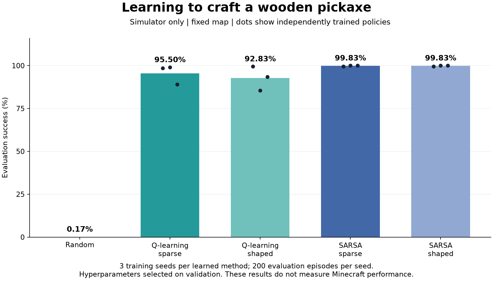

# Preliminary simulator results

These measured results come from the first resource/crafting simulator experiment. They do **not** measure actual Minecraft gameplay, natural-world generalization, or Ender Dragon completion. They are exploratory development evidence, not the final course study.

The run trained 24 agents: eight configurations, three training seeds per configuration, and 6,000 episodes per agent. It used 5,620,324 total training transitions and approximately 72.6 seconds of training time on this machine (excluding validation, testing, and artifact generation). No GPU was used. Each selected policy was evaluated for 200 episodes, giving 600 episodes per learned method. The random baseline used the same 600 episode seeds.

| Method | Task success | SD across 3 training seeds | Selected learning rate |
| --- | ---: | ---: | ---: |
| Random actions | 0.17% (1/600) | Not applicable | Not applicable |
| Q-learning, sparse | 95.50% (573/600) | 5.63 percentage points | 0.1 |
| Q-learning, shaped | 92.83% (557/600) | 7.02 percentage points | 0.3 |
| SARSA, sparse | 99.83% (599/600) | 0.29 percentage points | 0.1 |
| SARSA, shaped | 99.83% (599/600) | 0.29 percentage points | 0.1 |



Hyperparameters were selected on validation, with every selected training seed retained in testing. At this budget, SARSA was more consistent across the three seeds than Q-learning. Reward shaping did not improve completion over sparse rewards in these measurements. This small study does not establish universal superiority of SARSA or of either reward design.

An informative failure appears in the sparse Q-learning checkpoint with training seed 2: 11% of evaluation episodes timed out while none ended in lava death. The shaped Q-learning seed 1 checkpoint timed out in 14.5% of episodes. Inspect their state/action traces before attributing the mechanism; the metric alone does not prove a particular cause.

The fixed-map task is simple, uses a supplied workbench, and provides exact inventory/resource observations. The tested movement-slip distribution is also used for training. The larger course experiment reserves different validation/test episode-seed ranges and has not been run. Neither study tests new Minecraft worlds.

## Reproduce and inspect

From the repository root:

```powershell
.\.venv\Scripts\python.exe -m minecraft_rl experiment --config configs/smoke.json --out runs/reproduction
.\.venv\Scripts\python.exe -m minecraft_rl demo --policy results/baseline/demo_policy.json
```

The demo checkpoint is the **first prespecified training seed (0)** of validation-selected sparse SARSA. It was not chosen by taking the best test seed. `demo` shows a simulator trajectory only.

The original full run is in `runs/verified_baseline` on the development machine. All paths in the retained original summaries are relative to that run folder. The repository retains the configuration, source fingerprints, all validation candidate summaries, all 3,000 raw evaluation episodes in `evaluation_episodes.csv`, final summaries, and one example checkpoint. Full per-episode training logs and the other checkpoints can be regenerated with the command above.

To regenerate the comparison figure, install the optional plotting dependency and run:

```powershell
.\.venv\Scripts\python.exe -m pip install -e ".[plots]"
.\.venv\Scripts\python.exe scripts/plot_results.py results/baseline
```

See [the protocol](../../docs/experiment_protocol.md) for seed separation, uncertainty, and the distinction between training curves and frozen-policy evaluation. The retained source SHA256 hashes identify the files present when this experiment started; subsequent live-adapter fixes do not affect these simulator measurements.

